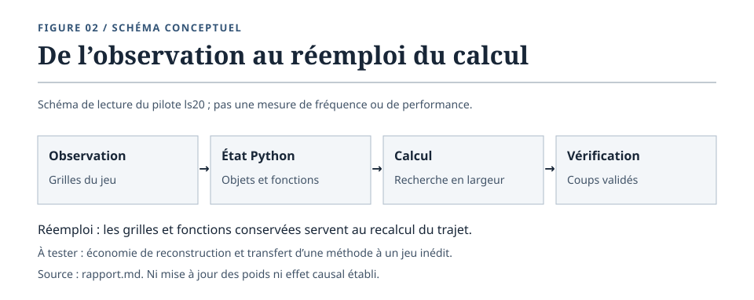
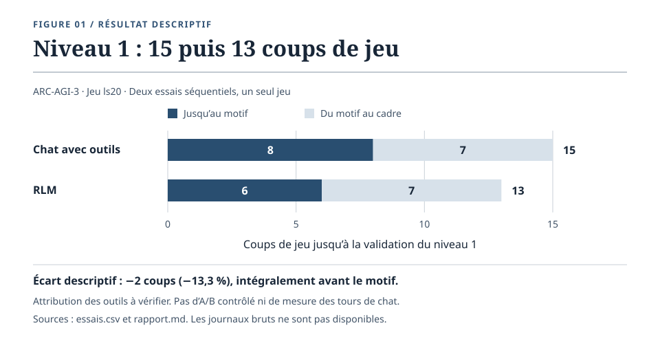
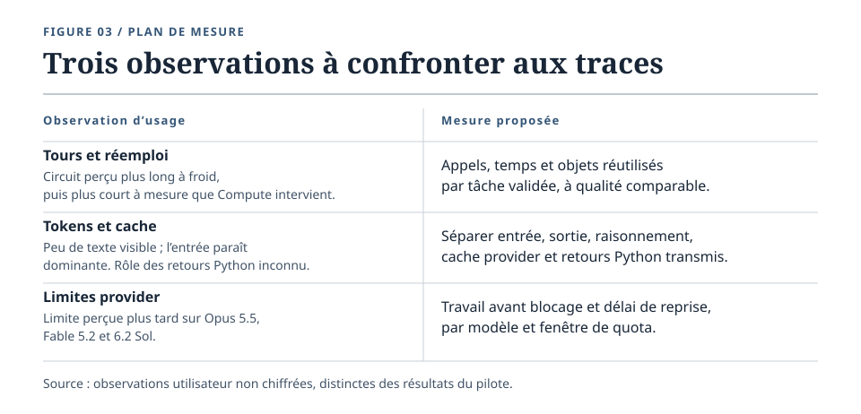

# RLM Harnesses and Inference-Time Learning: An Observational Case Study

**Public working draft. Independent practitioner report, not peer reviewed.** The observations and experiments described here were conducted in **Claake Code, the IDE developed and used by the author**. They include an ARC-AGI-3 pilot and 30-day aggregate usage exports. Exact dates, the complete pilot history, and some definitions remain to be verified. The author's role as developer of the system provides technical insight but may also influence interpretation.

## Abstract

A harness does more than pass a question to a model: it organizes tools, calls, and working state. This report examines two paths in Claake Code, classic chat and RLM chat based on Prime Agent. The central question is: **how might preserving and reusing computations within a session affect an agent's work and its user's experience?**

The author reports comparable everyday use of both paths, without intentionally changing working practices. The author perceives higher productivity, longer initial workflows followed by shorter turns as computation is reused, and less frequent rate-limit pressure on some models. A substantial token saving is suspected. **The available RLM exports do not quantify these impressions.**

An ARC-AGI-3 pilot on `ls20` reports level completion in 15 and then 13 game moves. The author reports an Auto Compute handoff from classic chat to RLM; the exact chronology and tools remain to be reconciled with the original report. Thirty-day statistics show descriptive differences in recorded turn errors by model, but tasks are not paired and RLM token usage measurements are unavailable. This document outlines a framework for further measurement without claiming a causal result.

## 1. Why study the harness?

A model generates responses from the context it receives. The **harness** is the software environment that organizes its work: it prepares context, provides tools, receives results, and coordinates subsequent operations. Two paths using the same model can therefore behave differently when their tools, state, and interaction rules differ.

The experiments took place in [Claake Code](https://github.com/WilliamPeynichou/ClaakeCode), the author's own IDE. Its classic and RLM chats are distinct paths. The former provides specialized tools; the latter relies on Prime Agent and a persistent Python runtime that lets the agent execute code and call programmable capabilities. **This is not an absolute distinction between having Python and not having Python**: the classic chat's exact capabilities depend on its configuration and must be specified for each trial.

A potential practical benefit is shifting some reconstruction into a usable state: structured data, functions, hypotheses, and plans may be maintained within a session rather than rebuilt from scratch at each step. Their costs and benefits remain to be measured.

## 2. What is meant by inference-time learning?

Here, the term describes **changes in the work and artifacts reused while the model is in use**, not changes to model weights. An agent can observe, construct a method, test it, and reuse it later in the session. In this operational sense, learning concerns the whole system: model, harness, and state, rather than model retraining.

Prime's Python runtime executes cells in a shared namespace for the runtime's lifetime. A function created in one cell or a grid loaded into memory can be reused by a later cell. The model must still know what to call and interpret the results returned by the harness; preserving an object does not establish correct use.

*Figure 2. Conceptual sequence inspired by the pilot: observation, structured state, computation, and verification. Reuse is possible within a session; its effect remains to be isolated experimentally.*

Three mechanisms must be distinguished:

- **Session Python state:** objects, variables, and functions in a live runtime. The author reports reuse within a session; survival after shutdown is not established here.
- **Persisted memory or artifacts:** files, notes, or methods explicitly saved and later reloaded. Their existence does not mean the live Python namespace survived.
- **Provider prompt cache:** a separate mechanism for reusing parts of model input. It can coexist with persistent Python and depends on the provider and instrumentation.

The author associates this approach with user-specific scalability: adapting methods to individual needs, reusing acquired artifacts, and potentially scaling workloads. These are distinct questions; the present data do not establish multi-task or multi-user scalability.

## 3. Exploratory pilot: ARC-AGI-3 `ls20`

The pilot reports a first level-one solution in **15 moves**, followed by a recalculated path in **13 moves**, a descriptive difference of **2 moves (13.3%)**. The segment before the pattern changes from 8 to 6 moves, while the segment between the pattern and the frame remains at 7. The 13-move path was replayed. Trials run to 30 actions completed one level; level two was not completed.

*Figure 1. Game moves to level-one completion, not chat turns or tokens. Source: `essais.csv` and `rapport.md`. Read with the qualification below.*

According to the author's later account, classic chat produced the 15-move path, after which Auto Compute transferred the conversation and tool results to a new RLM chat, which succeeded in 13 moves. The author reports the same model was used and that classic chat did not use Python. **The earlier pilot report instead stated that Python was already used in the first automated trial.** Raw logs had not been recovered when this document was written, so the exact tools, chronology, and meaning of “first attempt” require verification against the expected transcripts.

Even if this chronology is confirmed, the RLM would have received context from previous work. This would illustrate an **informed handoff**, not a cold-start comparison. The trials are sequential, cover one game, and do not isolate the effects of the REPL, Auto Compute, or transferred history. Thirteen is the shortest path found in the tested transition model, not a proven global minimum. The [pilot report](annexes/rapport.md) includes the timeout and other trials.

## 4. Thirty-day observability: available data

The [classic chat CSV](donnees/performance-modeles-chat-30j.csv) and [RLM CSV](donnees/performance-modeles-RLM-30j.csv), alongside the [classic](donnees/perfChat.md) and [RLM](donnees/perfRLM.md) interface snapshots, describe the author's personal use. Exact start and end dates remain to be documented. The author reports no intentional change in working practices, but the files cannot pair tasks or establish equivalent difficulty.

Each CSV contains **two consecutive tables**: historical statistics and a `measured_harness` section of measured turns. They must be imported separately. The RLM export's first section contains no rows; the second contains **79 turns** across five models. All five rows report `usage_turns = 0`: **token usage is unknown, not zero**. Fable 5.2 has no RLM row in this export.

Durations are medians grouped by model and path. Since tasks are unpaired and sample sizes differ, they describe observed usage, not an intrinsic speed difference. Duration and first-token medians are calculated independently, sometimes from different subsets, and should not be interpreted as a single representative turn.

### 4.1 Turn errors by model

*Figure 4. Turns recorded as errors divided by measured turns, for models in both `measured_harness` sections, excluding subagents. A turn error is not necessarily a model error; tasks and sample sizes differ.*

For Opus 5.5, the exports report **0 errors in 30 RLM turns**, versus **18 in 163 classic turns**. For 6.1 Sol, they report **9 in 22 RLM turns**, versus **12 in 99 classic turns**. Zero observed errors in 30 turns does not establish zero risk; these findings do not justify an overall ranking of the paths.

The author reports that the 6.1 Sol RLM errors came from a Prime Agent instance issue that has since been fixed. The exact link between that incident and the nine turns is not documented by traces in this repository. The errors remain in the raw figures; a sensitivity analysis could isolate them only after verifiable identification.

The Markdown snapshots and CSVs were reportedly captured at the same time, but some counts differ. For example, classic Sonnet 5.5 shows 134 turns in Markdown and 137 in the CSV. Filters or view refresh behavior remain to be checked. The figure uses CSV values without mixing them with the snapshots.

### 4.2 Tokens, cache, and rate limits

The author reports a **strong impression of token savings**, short visible output when task commentary is not requested, and an apparently input-dominated usage profile. Rate limits also appear to arrive later with Opus 5.5, Fable 5.2, and 6.2 Sol.

These observations motivate the study, but the available exports cannot calculate RLM token savings or determine when a limit was reached or reset. A variable in Python does not consume model tokens merely by existing; code, references, or results actually transmitted to the model can consume tokens. Short visible output does not establish fewer reasoning tokens either.

## 5. Next steps for measurement

*Figure 3. Hypotheses from personal use, not quantified results.*

Future records should include, per turn, the model and settings, task type, model and tool calls, duration, outcome, and usage counters **when actually available**. Created, reused, or reconstructed Python objects should also be distinguished without logging private contents.

The [proposed protocol](annexes/protocole.md) first compares reset Python with persistent Python under equal capabilities and with Auto Compute disabled. Separate ablations then consider automatic triggering and textual memory. Useful comparisons require paired tasks and models, success criteria fixed in advance, and all calls counted, including failures.

For rate limits, measure work before the first block, time to resumption, starting quota where known, and other usage sharing the window. For tokens, first expose and verify RLM measurements and their provider-specific semantics; missing must never silently become zero. See the [observability appendix](annexes/observabilite-rlm.md).

## 6. Provisional conclusion

The author's experience is encouraging enough to motivate investigation: a live Python environment can provide an agent with a workspace for preserving and reusing computations. The `ls20` pilot and usage statistics are concrete starting points, but **they establish neither token savings, a general error reduction, nor a causal RLM advantage**.

Further work will examine which methods are actually reused, how much they cost to construct, whether they help on unseen tasks, and whether perceived gains persist at comparable quality and under comparable conditions.

## Sources and reproduction

- [Pilot report](annexes/rapport.md) and [pilot data](donnees/essais.csv).
- [Observability hypotheses](annexes/observabilite-rlm.md) and [unexecuted protocol](annexes/protocole.md).
- [Classic chat data](donnees/performance-modeles-chat-30j.csv) and [RLM data](donnees/performance-modeles-RLM-30j.csv), aggregated personal usage.
- Figures 1 to 3: `python3 scripts/generer_graphique.py`; Figure 4: `python3 scripts/generer_erreurs.py`, from this directory.
- Before external dissemination, verify export privacy, document versions and dates, recover ARC-AGI-3 traces, and reconcile the stated discrepancies.
