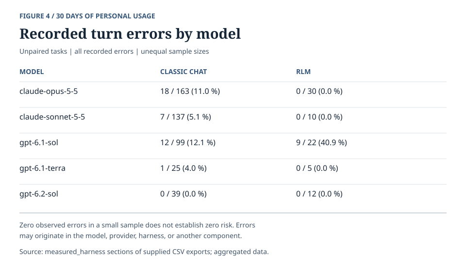

# Harness RLM et apprentissage à l’inférence : retour d’expérience sur un usage personnel

**Version de travail publique — retour d’expérience indépendant, non évalué par les pairs.** Les observations et essais décrits ici ont été réalisés dans **Claake Code, l’IDE développé par l’auteur**, qui en est également utilisateur. Ce document rassemble un pilote sur ARC-AGI-3 et des exports agrégés sur 30 jours. Les dates exactes, l’historique complet du pilote et certaines définitions restent à confirmer. Cette proximité avec le système étudié aide à en comprendre le fonctionnement, mais peut influencer l’interprétation.

## Résumé

Un harness ne se limite pas à transmettre une question à un modèle : il organise ses outils, ses appels et l’état de travail. Ce retour d’expérience examine deux parcours de Claake Code, le chat classique et le chat RLM fondé sur Prime Agent, avec une question centrale : **comment la conservation de calculs et leur réutilisation dans une session influencent-elles le travail de l’agent et de son utilisateur ?**

L’auteur rapporte une utilisation quotidienne comparable des deux parcours, sans changement intentionnel de manière de travailler. Il observe une production qu’il juge plus importante, des tâches initialement longues puis des tours plus courts lorsque le calcul se réutilise, ainsi qu’une moindre pression ressentie sur les limites de certains modèles. Il soupçonne une économie importante de tokens. **Ces impressions ne sont pas quantifiées par les exports RLM disponibles.**

Un pilote sur le jeu `ls20` d’ARC-AGI-3 rapporte une validation en 15 puis 13 coups de jeu. Un transfert Auto Compute entre le chat classique et le RLM est rapporté par l’auteur ; la chronologie exacte et les outils employés restent à réconcilier avec le rapport existant. Les statistiques de 30 jours montrent notamment des différences descriptives d’erreurs de tour par modèle, mais les tâches ne sont pas appariées et les mesures d’usage en tokens du RLM sont absentes. Ce texte propose un cadre pour poursuivre les mesures, sans revendiquer un résultat causal.

**Sommaire :** [1. Harness](#1-pourquoi-étudier-le-harness) · [2. Apprentissage à l’inférence](#2-que-signifie-ici--apprentissage-à-linférence-) · [3. Pilote ARC-AGI-3](#3-pilote-exploratoire--arc-agi-3-jeu-ls20) · [4. Observabilité](#4-observabilité-de-30-jours--données-disponibles) · [5. Mesures futures](#5-comment-poursuivre-la-mesure-) · [6. Conclusion](#6-conclusion-provisoire).

## 1. Pourquoi étudier le harness ?

Un modèle produit des réponses à partir du contexte qui lui est transmis. Le **harness** est l’environnement logiciel qui organise son travail : il prépare ce contexte, donne accès à des outils, reçoit leurs résultats et coordonne la suite des opérations. Deux parcours utilisant le même modèle peuvent donc se comporter différemment si leurs outils, leur état et leurs règles d’interaction diffèrent.

Les essais présentés ont été menés dans [Claake Code](https://github.com/WilliamPeynichou/ClaakeCode), l’IDE personnel développé par l’auteur. Son chat classique et son chat RLM sont deux parcours distincts. Le premier présente à l’agent des outils spécialisés. Le second s’appuie sur Prime Agent et un environnement Python persistant ; Prime expose notamment un REPL dans lequel l’agent peut exécuter du code et appeler des capacités programmatiques. **Ce n’est pas une opposition absolue entre « avec Python » et « sans Python »** : les capacités exactes du chat classique dépendent de sa configuration et doivent être précisées pour chaque essai.

L’intérêt pratique est de déplacer une partie du travail de reconstruction vers un état exploitable : données structurées, fonctions, hypothèses et plans peuvent être maintenus au cours d’une session plutôt que reconstitués entièrement à chaque étape. Cela ouvre des possibilités ; leur coût et leurs bénéfices doivent encore être mesurés.

## 2. Que signifie ici « apprentissage à l’inférence » ?

Dans ce document, l’expression désigne **un changement du travail et des éléments réutilisés pendant l’usage du modèle**, et non une modification de ses poids. Un agent peut observer, construire une méthode, la tester et la réemployer dans la suite de la session. Appeler cela « apprentissage » décrit ici une capacité opérationnelle du système complet — modèle, harness et état — plutôt qu’un entraînement du modèle lui-même.

Le runtime Python de Prime exécute des cellules dans un même espace de noms pendant sa durée de vie. Une fonction créée dans une cellule ou une grille chargée en mémoire peut donc être réutilisée par une cellule ultérieure. Le modèle doit néanmoins savoir quoi appeler et interpréter les résultats que le harness lui transmet ; conserver un objet ne prouve pas qu’il sera utilisé correctement.

*Figure 2. Schéma conceptuel inspiré du pilote : observation → état structuré → calcul → vérification. Le réemploi est possible dans une même session ; son effet reste à isoler expérimentalement.*

Trois mécanismes sont à distinguer :

- **État Python de la session** : objets, variables et fonctions présents dans le runtime vivant. L’auteur rapporte leur réemploi dans une même session ; ce document ne démontre pas leur survie à une fermeture.
- **Mémoire ou artefacts persistés** : fichiers, notes ou méthodes enregistrés puis rechargés explicitement. Leur existence ne signifie pas que l’espace Python vivant a survécu.
- **Cache de prompt du fournisseur** : mécanisme distinct de réutilisation de parties du contexte envoyé au modèle. Il peut coexister avec Python persistant ; son utilisation dépend du fournisseur et de l’instrumentation.

L’auteur associe cette approche à une « scalabilité propre à l’utilisateur » : adaptation des méthodes à ses besoins, réutilisation des acquis et possibilité de montée en charge. Ce sont trois pistes distinctes ; les données présentées ici ne démontrent pas encore la montée en charge multi-tâches ou multi-utilisateurs.

## 3. Pilote exploratoire : ARC-AGI-3, jeu `ls20`

Le pilote rapporte un premier trajet validant le niveau 1 en **15 coups**, puis un trajet recalculé en **13 coups**, soit un écart descriptif de **2 coups (13,3 %)**. Le segment avant le motif passe de 8 à 6 coups ; celui entre le motif et le cadre reste à 7. Le trajet de 13 coups a été rejoué. Les essais menés jusqu’à 30 actions terminent un niveau ; le niveau 2 n’a pas été terminé.

*Figure 1. Coups de jeu jusqu’à la validation du niveau 1, et non tours de chat ni tokens. Source : `essais.csv` et `rapport.md`. La figure est à lire avec la réserve ci-dessous.*

Selon le témoignage recueilli ensuite, le chat classique a réalisé le trajet de 15 coups, puis Auto Compute a transmis la conversation et des résultats d’outils à un nouveau chat RLM, qui a réussi en 13 coups. L’auteur indique que le même modèle était utilisé et que le chat classique n’utilisait pas Python. **Le rapport du pilote indique au contraire que Python était déjà utilisé dans le premier essai automatisé.** Les journaux bruts n’ont pas été retrouvés au moment de la rédaction : les outils exacts, la chronologie et la nature de « premier essai » restent donc à vérifier dans les restitutions et l’historique attendus.

Même si cette chronologie est confirmée, le RLM aurait reçu un contexte issu du travail précédent. Le cas illustrerait alors une **reprise informée**, et non une comparaison à froid. Les essais sont séquentiels, portent sur un seul jeu et n’isolent pas l’effet propre du REPL, d’Auto Compute ou de l’historique transmis. Treize coups est le plus court trajet trouvé dans le modèle testé, pas un minimum absolu établi. Les résultats détaillés et le timeout sont dans le [rapport du pilote](annexes/rapport.md).

## 4. Observabilité de 30 jours : données disponibles

Les fichiers [`performance-modeles-chat-30j.csv`](donnees/performance-modeles-chat-30j.csv) et [`performance-modeles-RLM-30j.csv`](donnees/performance-modeles-RLM-30j.csv), accompagnés de [`perfChat.md`](donnees/perfChat.md) et [`perfRLM.md`](donnees/perfRLM.md), décrivent l’usage personnel de l’auteur. Les dates exactes de début et de fin restent à documenter. L’auteur indique ne pas avoir intentionnellement modifié sa manière de travailler entre les deux modes, mais les fichiers ne permettent pas d’apparier les tâches ni d’établir leur difficulté respective.

Chaque CSV contient **deux tableaux successifs** : des statistiques issues de l’historique, puis une section `measured_harness` avec des tours mesurés. Ils doivent être importés séparément. La première section de l’export RLM ne contient aucune ligne ; la seconde contient **79 tours** répartis sur cinq modèles. Les cinq lignes indiquent `usage_turns = 0` : **l’usage en tokens est inconnu, pas nul**. Le RLM Fable 5.2 ne figure pas dans cet export.

Les durées présentées sont des médianes par modèle et parcours. Comme les tâches ne sont pas appariées et que le nombre de tours varie, elles décrivent cet usage mais ne mesurent pas une différence intrinsèque de vitesse. Les médianes de durée et de premier token sont calculées séparément, parfois sur des ensembles de tours différents : il ne faut pas les traiter comme si elles décrivaient un même tour représentatif.

### 4.1 Erreurs de tour : une lecture par modèle

*Figure 4. Nombre de tours enregistrés en erreur / nombre de tours mesurés, pour les modèles présents dans les deux sections `measured_harness`, hors sous-agents. Les erreurs de tour ne sont pas nécessairement des erreurs du modèle ; les tâches et tailles d’échantillon diffèrent.*

Pour Opus 5.5, les exports indiquent **0 erreur sur 30 tours RLM**, contre **18 sur 163 tours classiques**. Pour 6.1 Sol, ils indiquent **9 sur 22 tours RLM**, contre **12 sur 99 tours classiques**. Un taux nul avec 30 tours ne démontre pas l’absence de risque, et ces constats ne permettent pas de classer globalement les deux parcours.

L’auteur indique que les erreurs RLM 6.1 Sol provenaient d’un problème d’instances côté Prime Agent corrigé depuis. Le lien précis entre cet incident et les neuf tours n’est pas encore documenté par des traces dans le dossier. Les erreurs restent donc incluses dans les chiffres bruts ; une analyse complémentaire ne pourrait les isoler qu’après identification vérifiable.

Les fichiers Markdown et CSV ont été déclarés relevés au même moment, mais certains effectifs diffèrent : par exemple, Sonnet 5.5 classique affiche 134 tours dans le Markdown et 137 dans le CSV. Les filtres ou l’actualisation de la vue restent à vérifier. La figure utilise les CSV, sans mélanger leurs valeurs avec celles des Markdown.

### 4.2 Tokens, cache et limites : ne pas transformer une absence en résultat

L’auteur rapporte une **forte impression d’économie de tokens**, une sortie visible courte lorsqu’il ne demande pas de commentaires, et une entrée qui lui paraît dominante. Il observe aussi que les limites semblent arriver moins vite sur Opus 5.5, Fable 5.2 et 6.2 Sol.

Ces observations motivent l’étude, mais les exports disponibles ne permettent pas de calculer une économie de tokens RLM ni d’établir quand une limite a été atteinte ou réinitialisée. Une variable présente dans Python ne consomme pas de tokens par sa seule présence ; le code, les références ou les résultats effectivement transmis au modèle peuvent en consommer. Une sortie visible courte ne prouve pas non plus que les tokens de raisonnement sont moins nombreux.

## 5. Comment poursuivre la mesure ?

*Figure 3. Hypothèses issues de l’usage personnel ; elles ne représentent pas des résultats chiffrés.*

La prochaine étape consiste à conserver, pour chaque tour, le modèle et sa configuration, le type de tâche, les appels modèle et outils, la durée, l’issue, et les compteurs d’usage **quand ils sont effectivement disponibles**. Il faudra aussi distinguer les objets Python créés, réutilisés ou reconstruits, sans enregistrer leur contenu privé.

Pour examiner le mécanisme, le [protocole proposé](annexes/protocole.md) compare d’abord Python réinitialisé et Python persistant avec les mêmes capacités et Auto Compute désactivé. Il prévoit ensuite des ablations séparées pour le déclenchement automatique et la mémoire textuelle. Une comparaison utile demanderait des tâches et modèles appariés, des critères de réussite fixés avant les essais et la prise en compte du coût de tous les appels, y compris les échecs.

Pour les limites fournisseur, il faudra mesurer séparément le travail avant le premier blocage, le délai de reprise, le quota de départ lorsqu’il est connu et les autres usages partageant la fenêtre. Pour les tokens, il faut d’abord exposer et vérifier les mesures RLM et leur sémantique par fournisseur ; un champ non renseigné ne doit jamais devenir un zéro implicite. Le détail des champs proposés figure dans [Observabilité RLM](annexes/observabilite-rlm.md).

## 6. Conclusion provisoire

L’expérience de l’auteur est suffisamment encourageante pour justifier une investigation : un environnement Python vivant peut fournir à l’agent un espace de travail où conserver et réutiliser des calculs. Le pilote `ls20` et les statistiques d’usage donnent des points de départ concrets, mais **ne démontrent ni une économie de tokens, ni une réduction générale des erreurs, ni un gain causal du RLM**.

La suite recherchera ce qui peut être établi : quelles méthodes sont réellement réutilisées, combien coûte leur construction, si elles aident sur des tâches inédites et si les gains perçus persistent à qualité et conditions comparables.

## Sources et reproduction

- [Rapport du pilote et limites](annexes/rapport.md) ; [données du pilote](donnees/essais.csv).
- [Observabilité et hypothèses](annexes/observabilite-rlm.md) ; [protocole non exécuté](annexes/protocole.md).
- [Données chat](donnees/performance-modeles-chat-30j.csv) et [données RLM](donnees/performance-modeles-RLM-30j.csv), usage personnel agrégé.
- Figures 1 à 3 : `python3 scripts/generer_graphique.py` ; figure 4 : `python3 scripts/generer_erreurs.py`, depuis ce dossier.
- Avant diffusion publique : vérifier la confidentialité des exports, préciser les versions et dates, retrouver les traces ARC-AGI-3 et réconcilier les divergences signalées.
